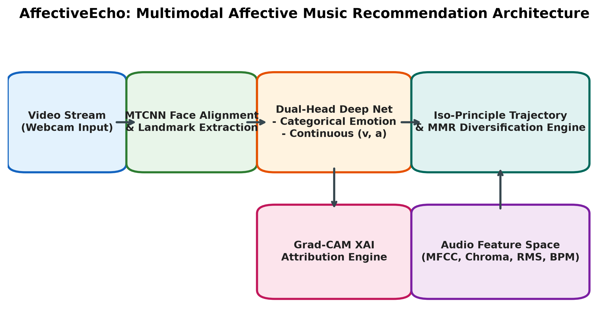

# AffectiveEcho

### Evidence-first multimodal affect modelling and music recommendation

<p align="left">
  
  
  
  
</p>

> **AffectiveEcho is a research framework for connecting facial affect, continuous valence–arousal representations, and diversity-aware music recommendation—without overstating what its data can prove.**

<p align="center">
  
</p>

## Why this project exists

Most emotion-aware music demos stop at a discrete expression label and a fixed playlist. AffectiveEcho investigates a more rigorous alternative:

| Perception | Representation | Recommendation | Accountability |
| --- | --- | --- | --- |
| Facial affect inference | Categorical emotion + valence/arousal | Smooth affect trajectory + MMR diversity | Explainability, provenance, confidence intervals |

The goal is not to promise therapy or clinical benefit. The goal is to build a transparent, testable research system whose claims grow only when the evidence does.

## Research components

```text
Camera frame → face alignment → affect backbone → affect state
                                      │
                                      ├── Grad-CAM explanation
                                      │
Audio features → valence/arousal map ─┴→ trajectory-aware MMR ranking → playlist
```

- **Affective perception** — dual-head architecture for categorical emotion and continuous valence–arousal predictions.
- **Music intelligence** — acoustic feature extraction, affect-space mapping, trajectory-aware ranking, and Maximal Marginal Relevance diversification.
- **Transparent engineering** — Grad-CAM support, validation guards, manifest auditing, reproducible checkpoints, and raw prediction export.
- **Publication discipline** — synthetic benchmarks are explicitly segregated from empirical results; every reportable value needs traceable source data.

## Evidence status

| Capability | Status | Reporting rule |
| --- | --- | --- |
| FER2013 categorical emotion baseline | Real GPU experiment complete | Report only with its data/split provenance |
| Continuous valence–arousal | Pending an authorised annotated dataset | Do not claim performance yet |
| Music recommendation evaluation | Pipeline implemented | Needs independent relevance labels/interactions |
| Human study / clinical impact | Not conducted | No therapeutic or usability claim |

The full protocol is available in [RESEARCH_EXECUTION_PROTOCOL.md](paper/RESEARCH_EXECUTION_PROTOCOL.md).
The measured FER2013 results and their reporting boundary are recorded in [RESULTS.md](RESULTS.md).

## Reproduce the categorical baseline

```powershell
# 1. Obtain the authorised FER2013 dataset under data/external/fer2013
python experiments/prepare_fer2013.py
python experiments/validate_manifest.py --manifest artifacts/fer2013_manifest.csv

# 2. Train locally (GPU recommended)
python experiments/train_dual_head.py `
  --manifest artifacts/fer2013_manifest.csv `
  --output-dir artifacts/fer2013_run_001 `
  --classification-only --class-balanced
```

For a held-out evaluation, retain raw predictions and use:

```powershell
python experiments/evaluate_real_results.py --help
```

## Repository map

| Directory | Purpose |
| --- | --- |
| `src/vision/` | face processing, affect model, and explainability |
| `src/audio/` | real audio-feature extraction and affect mapping |
| `src/recommender/` | trajectory-aware and diversity-aware ranking |
| `experiments/` | manifest validation, training, and real-result evaluation |
| `kaggle_kernel/` | GPU experiment configurations |
| `paper/` | references, publication figures, and evidence protocol |
| `demo/` | interactive demonstration surfaces |

## Quality bar

Before any manuscript submission, the project requires licensed data, locked train/validation/test protocol, raw predictions, checkpoint hashes, uncertainty estimates, independent recommendation labels, and ethics approval where human participants are involved. See [REPRODUCIBILITY.md](REPRODUCIBILITY.md).

---

Built as an open, evidence-first research project by **Mursalin**.
